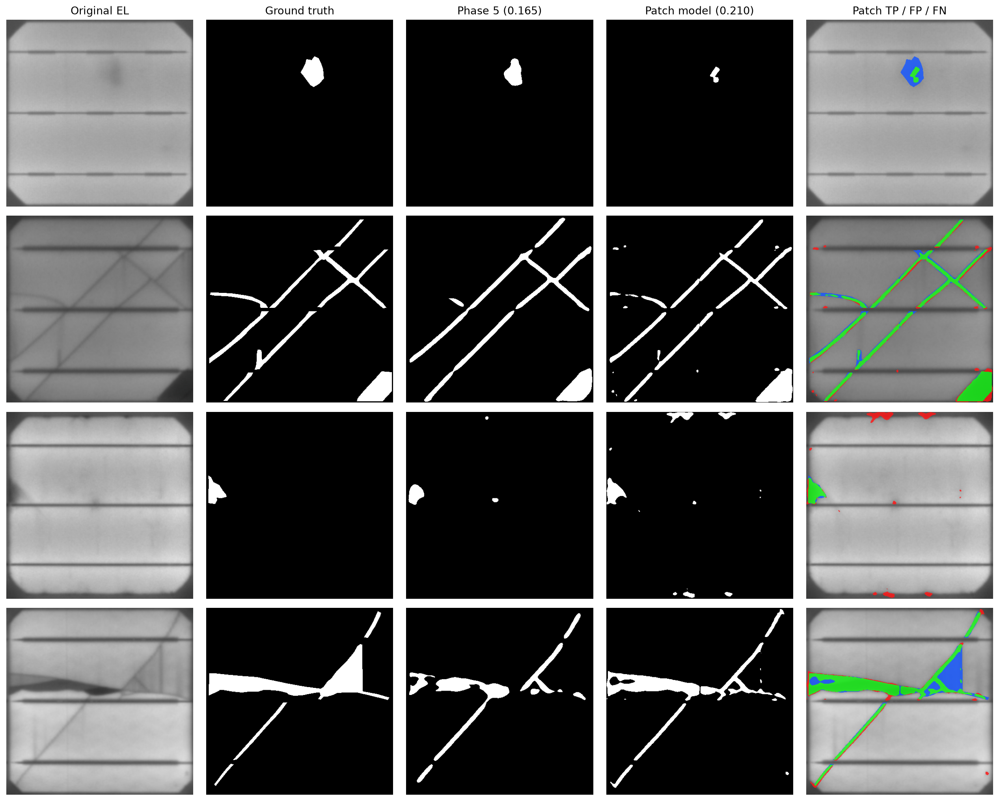

# Solar Cell Defect Segmentation — Work Summary

This document records the project as it exists in the working tree at the time
of writing. It distinguishes implemented functionality and available artifacts
from goals that remain future work.

## 1. Project purpose

The project uses electroluminescence (EL) images of photovoltaic cells to
identify defects. The implemented pipeline focuses on **binary defect-mask
segmentation with U-Net models**; classification and defect-type prediction
are not implemented.

## 2. Work completed

### Data preparation

The preprocessing script in `src/preprocessing.py` reads raw data from
`data/SolarCells`. It expects separate `train` and `test` splits, each with
`defect` images and corresponding `label` masks.

For each split, the script:

1. Recursively finds supported image files and matches images to masks by
   filename stem. Label suffixes such as `_mask`, `_label`, `_groundtruth`, and
   `_gt` are normalized for matching; matching is case-insensitive.
2. Detects duplicate stems and records images without labels and labels without
   images. It reports processing and pairing issues rather than silently
   treating incomplete pairs as successful.
3. Checks for related or augmented versions of an original image appearing in
   both train and test splits, and writes any potential overlaps to a report.
4. Applies EXIF orientation correction to each EL image, converts it to RGB,
   and resizes it to **224 × 224** using bilinear interpolation.
5. Converts each mask to grayscale, resizes it to **224 × 224** using nearest
   neighbor interpolation, and thresholds pixel values at 127 to produce a
   binary mask with values **0** and **1**.
6. Writes paired PNGs under `data/processed/SolarCells/{train,test}/images`
   and `.../masks`.
7. Writes CSV diagnostics under `results/preprocessing`: the overall
   preprocessing report, per-split pairing-issue reports, an empty-mask
   report, and a possible train/test-overlap report. If pairs are incomplete
   or fail processing, it reports the problem and stops with an error.
8. Removes stale image and mask outputs after a successful complete run.

The preprocessing notebook, `work/01_Data_Preprocessing.ipynb`, contains
exploratory checks of processed image/mask pairs and mask values, plus a small
mask preprocessing and visualization example.

At the time this document was written, the processed dataset contained **134
training pairs** and **56 test pairs**. These counts describe the local data
snapshot and may change if the dataset is updated or preprocessing is rerun.

### Dataset loading and splits

`src/dataset.py` implements `SolarCellDataset` and `get_dataloaders`:

- It verifies that image and mask directories exist, file stems pair
  one-to-one, images and masks have matching dimensions, and masks contain
  only 0 and 1.
- Images are converted to RGB and normalized using ImageNet channel means and
  standard deviations. Masks are returned as single-channel float tensors.
- Each sample also gets a binary cell-level label derived from whether its
  mask contains any defect pixels.
- The processed training set is split deterministically into training and
  validation subsets. The current pipeline uses a **20% validation fraction**
  and seed **42**; the processed test set remains separate.
- The loader returns batches of `(image, mask, class_label)`. The current
  training and evaluation code uses the images and masks.

### Segmentation model and training

`src/models.py` defines a U-Net for three-channel EL images and one-channel
defect masks. It uses convolution blocks with batch normalization and ReLU,
three downsampling stages, transposed-convolution upsampling, and skip
connections. The final sigmoid produces per-pixel probabilities.

`src/train.py` trains this model with:

- A combined binary cross-entropy and Dice loss.
- The Adam optimizer, with a default learning rate of **0.001**.
- **15 epochs** in the current `main.py` entry point.
- Validation Dice and IoU calculations after each epoch.
- A validation threshold search over **0.1 to 0.9**, selecting the threshold
  with the highest validation Dice for that epoch. The threshold selected on
  the final epoch is returned to the evaluation step.

New training runs save the model state to
`results/unet_solar_defect_retrained.pth`. The historical checkpoint used by
the app is stored separately at `results/unet_solar_defect.pth`.
Training saves the final epoch's model state;
it does not currently retain and restore a best-validation checkpoint.

### Test evaluation and visualization

`src/evaluate.py` evaluates the test loader using the chosen threshold and
reports Dice and intersection-over-union (IoU). It also saves a visualization
for up to four test samples, showing:

1. The input EL image.
2. Its ground-truth mask.
3. The thresholded prediction after a 3 × 3 morphological opening to remove
   isolated foreground pixels.

The current entry point writes the figure to
`results/phase3_evaluation_results.png`.

### End-to-end entry point

Running `python main.py` from the project directory:

1. Selects CUDA when available, otherwise CPU.
2. Loads the processed train and test data and makes the deterministic
   train/validation split.
3. Creates and trains the U-Net.
4. Saves the checkpoint and evaluates and visualizes test predictions.

Project paths are anchored to the location of `main.py`, rather than depending
on the shell's current directory.

### Phase 4 preparation and baseline measurement

The existing baseline checkpoint `results/unet_solar_defect.pth` was loaded
and evaluated without retraining. The deterministic split contains 107
training, 27 validation, and 56 test pairs. The test data was not used for
threshold selection. Per-image (macro) metrics at the validation-selected
threshold of 0.5 are:

| Metric | Existing custom U-Net |
|---|---:|
| Validation Dice at threshold 0.3 | 0.6714 |
| Validation Dice at threshold 0.4 | 0.6864 |
| Validation Dice at threshold 0.5 | 0.6917 |
| Validation Dice at threshold 0.6 | 0.6914 |
| Validation Dice at threshold 0.7 | 0.6877 |
| Selected validation threshold | 0.5 |
| Test Dice / F1 | 0.6980 |
| Test IoU | 0.5492 |
| Test precision | 0.7230 |
| Test recall | 0.7384 |
| CPU inference time | 0.3222 s/image (batch size 8, six default threads; comparison run) |
| Training time | Not recorded in the existing checkpoint |

These are per-image averages; F1 equals Dice under these definitions. Defect
pixels account for 7.47% of the training pixels, 9.37% of validation pixels,
and 6.52% of test pixels. All images in these three splits have non-empty
masks. BCE + Dice is retained for the first transfer-learning experiment; the
current evidence does not justify changing the loss or sampling strategy.

The old training loop selected a threshold from 0.1–0.9 using validation
predictions after each epoch and returned the last epoch's validation-selected
threshold. It did not tune on test data. The measured 0.5 baseline threshold
also maximizes validation Dice over the requested 0.3–0.7 candidates. Visual
inspection of the existing evaluation examples shows occasional gaps in thin
cracks and isolated false-positive pixels; grid-line regions remain a
potential source of confusion and need targeted review in the model
comparison. These are qualitative observations, not a separate scored error
analysis.

`SolarCellDataset` now supports synchronized horizontal/vertical flips and
right-angle rotations, plus mild brightness/contrast changes to images only.
`get_dataloaders(..., augment_training=True)` enables them only for the
training subset. Validation and test samples use unaugmented datasets, and
geometric transforms preserve binary masks.

`src/models.py` now includes a ResNet-18 encoder with a U-Net decoder and
single-channel sigmoid output. The decoder uses multi-scale skip connections
and is structured to accept a different encoder feature-channel layout later.
The model starts with a frozen encoder; its final block can be explicitly
unfrozen for optional fine-tuning. The default experiment uses torchvision's
pretrained ResNet-18 weights. The pretrained weights have now been downloaded
to the local PyTorch cache; a fresh environment may need network access to
download them. `--no-pretrained` is available only as an explicit fallback
and is not equivalent to the transfer-learning experiment.

`src/train_resnet_unet.py` provides CPU training with AdamW, the existing
BCE + Dice loss, up to 20 frozen-encoder epochs, batch size eight by default,
and PyTorch's default thread count unless `--num-threads` is provided.
Validation thresholds are selected from 0.3–0.7; early stopping uses patience
three, and the script records per-epoch timing and best-validation-Dice
checkpoints. A separate explicit `--fine-tune` run can unfreeze only ResNet
layer 4 for at most three epochs and stops after the first epoch that fails to
exceed the Stage 1 best validation Dice. Checkpoints use separate prefixes
and do not replace the baseline U-Net checkpoint or Phase 3 visualization.

The initial five-epoch ResNet experiment (batch size four, four threads)
completed in 134.3 seconds. It achieved validation Dice 0.6957 at threshold
0.6, but its selected-threshold test results were below the existing U-Net:

| Metric | Custom U-Net | ResNet-18 U-Net (5 epochs) |
|---|---:|---:|
| Test Dice / F1 | 0.6980 | 0.6500 |
| Test IoU | 0.5492 | 0.5079 |
| Test precision | 0.7230 | 0.6507 |
| Test recall | 0.7384 | 0.7409 |
| Validation-selected threshold | 0.5 | 0.6 |
| Inference time (seconds/image) | 0.2983 | 0.0873 |
| Training time | Not recorded | 134.3 seconds |

Thus, this first transfer-learning run did not improve test Dice, IoU, or
precision; recall was nearly unchanged. The Phase 4 visual comparison
illustrates similar or worse localization in these examples and should not be
interpreted as evidence of improvement. `src/compare_models.py` selects
examples containing small and elongated annotations and strong grid-line
patterns. Its newer overlay view distinguishes correct predictions (green),
false positives (red), and missed defects (blue).

The requested longer run used batch size eight and the default six PyTorch CPU
threads. It early-stopped after 14 of 20 maximum epochs, with best validation
Dice 0.7554 at threshold 0.7 (epoch 11) and 339.6 seconds cumulative training
time. On the same held-out test set:

| Metric | Custom U-Net | ResNet-18 U-Net (up to 20 epochs) |
|---|---:|---:|
| Test Dice / F1 | 0.6980 | 0.6959 |
| Test IoU | 0.5492 | 0.5532 |
| Test precision | 0.7230 | 0.6460 |
| Test recall | 0.7384 | 0.8200 |
| Validation-selected threshold | 0.5 | 0.7 |
| Inference time (seconds/image) | 0.3222 | 0.0889 |
| Training time | Not recorded | 339.6 seconds |

The longer run improved substantially over the five-epoch ResNet experiment,
but did not improve overall test Dice over the custom U-Net: Dice is about
0.002 lower, while IoU is about 0.004 higher. It trades lower precision for
higher recall, so the examples may show more detected defect pixels without
improved localization overall. The overlay comparison is saved as
`results/phase4_model_comparison_20ep.png`; its CSV is
`results/phase4_model_comparison_20ep.csv`. No claim of overall model
improvement is supported by these results.

An optional final-block fine-tuning attempt was made because the Stage 1
validation score exceeded the custom U-Net validation score. It failed to
improve the Stage 1 best validation Dice on its first epoch (0.6987 vs 0.7554),
so early stopping retained the frozen-encoder checkpoint. The selected
20-epoch-prefix checkpoint therefore remains the Stage 1 model.

## 3. Phase 5 analysis and proposed targeted experiment

`src/phase5_analysis.py` evaluates the saved custom U-Net, five-epoch ResNet
checkpoint, and longer ResNet checkpoint using the same deterministic split
and per-image macro metric definitions. It fine-calibrates thresholds on the
27-image validation split, evaluates each model once on the held-out test
split at its validation-selected threshold, and writes these reports:

- `results/phase5_model_comparison.csv` — validation/test metrics, pixel
  confusion counts, CPU inference time, training time where recorded, and
  false-positive proximity to image-derived dark-line regions.
- `results/phase5_validation_thresholds.csv` — all validation-only threshold
  candidates and metrics.
- `results/phase5_per_image_errors.csv` — per-image TP, FP, FN, Dice, and
  dark-line-proximity counts.
- `results/phase5_dataset_statistics.csv` — split-level defect pixel and
  mask-size distributions, plus raw-component resize-retention checks.
- `results/phase5_qualitative_errors.png` and
  `results/phase5_visual_examples.csv` — representative best/worst,
  small-mask, and dark-linear-region examples with TP/FP/FN overlays.

### Findings from saved predictions

The reported Dice, IoU, precision, and recall are **per-image macro averages**
for all compared models. Within each image, F1 is the same as Dice. The analysis
also reports pixel-level confusion counts and micro Dice separately; macro
and micro metrics are not interchangeable. The earlier evaluation helper and
the current comparison use the same per-image averaging convention (the
helper's small smoothing term accounts for negligible numerical differences).

The validation-only fine threshold sweep selected **0.525** for the custom
U-Net, **0.600** for the initial ResNet, and **0.800** for the 20-epoch ResNet
run. For the latter, validation Dice rises from 0.7554 at 0.700 to 0.7662 at
0.800, then is nearly flat at 0.7660 at 0.825; higher thresholds reduce Dice.
Thus, the prior 0.700 selection was correct only within its coarse candidate
set, not the finer range. Threshold selection itself is operating correctly
and uses validation data only.

At these thresholds the longer ResNet reaches test Dice 0.7094, IoU 0.5719,
precision 0.6989, and recall 0.7841. This is a small Dice/IoU gain over the
custom U-Net (0.6994 / 0.5505) at the cost of precision. The initial ResNet
test Dice remains lower at 0.6500. Pixel-level counts for the longer ResNet
are 152,153 TP, 51,773 FP, and 31,020 FN; the custom U-Net has 132,375 TP,
31,736 FP, and 50,798 FN. Therefore, the ResNet is finding more labeled
pixels but also produces substantially more false-positive pixels.

The saved predictions support an over-segmentation explanation for the
ResNet's lower precision: at the selected thresholds it predicts more defect
pixels than ground truth in 41/56 test images, with median predicted/ground
truth area ratio 1.166 (custom U-Net: 25/56 and 0.971). The five-epoch
checkpoint is more pronounced at 38/56 and ratio 1.243. This is a pixel-area
proxy for thickness/extent, not a claim that every predicted crack is
geometrically thicker.

To check possible grid-line confusion, the analysis marks dark elongated
structures with directional morphological black-hat filters and a 7-pixel
dilation. This is an image-derived **proxy**, not a semantic grid-line label.
For the longer ResNet, 29,288/51,773 (56.6%) false-positive pixels fall near
the proxy, which covers 34.3% of all background pixels; the FP rate is 3.25%
inside the proxy versus 1.30% outside. This indicates errors are concentrated
near some dark linear structures, consistent with grid-line confusion, but
does not prove that every such error is on a normal grid line. The selected
qualitative examples also show false positives in textured/dark regions.

Validation and test masks have different observed distributions: foreground
is 9.37% of validation pixels versus 6.52% of test pixels; median
per-image foreground is 6.42% versus 3.75%. Masks occupying no more than 2%
of an image occur in 5/27 validation images and 18/56 test images. The 107
training-subset images have 7.47% defect pixels, and 22/107 masks occupy no
more than 2%. All images are annotated as non-empty. The test set therefore
has a higher share of small masks than validation, which can make validation
threshold calibration less representative.

Raw input/mask dimensions are 448 × 448 and preprocessing resizes them to
224 × 224 using nearest-neighbor for masks. The raw-mask check found seven
raw training and one raw test connected components of at most 64 pixels; none
of these components disappeared under the actual nearest-neighbor resize.
After preprocessing, the training subset has five connected components below
20 pixels and the test set has two. Small defects remain a concern, but the
available labels do not show evidence that resize is deleting entire labeled
components. Existing flips, right-angle rotations, and mild image-only
brightness/contrast changes are already applied on training data only.
Additional augmentation or sampling is not justified by these observations.

On the training subset, background accounts for 92.53% of pixels. For the
saved ResNet checkpoint, negative pixels contributed 90.35% of the measured
unweighted BCE sum, while positive pixels contributed 9.65%. BCE is therefore
background-dominated, though Dice supplies an additional overlap objective.
The targeted experiment used a **modest 1.1 weight on negative/background BCE
pixels**, leaving the Dice term, model, input resolution, augmentation,
optimizer, and frozen encoder unchanged. The weight-one loss is numerically
equivalent to the previous unweighted BCE + Dice loss.

The weighted-loss path is implemented in `src/train.py` and
`src/train_resnet_unet.py`; `--initialize-from` loads the existing 20-epoch
ResNet best checkpoint and starts a fresh optimizer/run. The experiment ran
for **8 epochs** (best validation epoch 7), with batch size 8, six CPU threads,
and 195.2 seconds of training time. Early stopping remained enabled with
patience three; the run reached its 8-epoch cap. The frozen encoder and
training-only augmentation were unchanged. This completed run used a
training-time checkpoint-selection threshold range of 0.3–0.95 in 0.025
increments. The subsequent validation-only calibration found that the saved
checkpoint's best threshold was below that range; the training script's grid
has since been widened to 0.1–0.95 in 0.025 increments and its threshold log
precision increased to three decimals. The existing checkpoint and its
training history have not been changed or retrained.

### Controlled experiment results

The fine validation sweep selected threshold **0.175** for the Phase 5 model
(Dice 0.8075, IoU 0.6863, precision 0.8283, recall 0.8048). At this
validation-selected threshold, the held-out test results are:

| Model | Validation Dice | Test Dice / F1 | Test IoU | Test precision | Test recall | Training time | Inference sec/image |
|---|---:|---:|---:|---:|---:|---:|---:|
| Custom U-Net | 0.6924 | 0.6994 | 0.5505 | 0.7300 | 0.7330 | Not recorded | 0.3794 |
| ResNet-18 U-Net (5 epochs) | 0.6957 | 0.6500 | 0.5079 | 0.6507 | 0.7409 | 134.3 s | 0.0827 |
| ResNet-18 U-Net (20-epoch run) | 0.7662 | 0.7094 | 0.5719 | 0.6989 | 0.7841 | 339.6 s | 0.0845 |
| ResNet-18 U-Net (Phase 5) | 0.8075 | 0.7572 | 0.6267 | 0.7606 | 0.7833 | 195.2 s | 0.0837 |

All metrics are per-image macro averages from identical splits and definitions;
times are CPU measurements at batch size 8 and six threads, with custom U-Net
training time unavailable. The Phase 5 run improved test Dice by 0.0478, IoU
by 0.0548, and precision by 0.0616 over the prior 20-epoch ResNet, with recall
essentially unchanged (-0.0008). Its test false-positive count fell from
51,773 to 32,480 (-37.3%); true positives fell by 4,501 and false negatives
rose by the same amount, consistent with nearly unchanged pixel recall.
Compared with the custom U-Net, Phase 5 improved test Dice by 0.0578, IoU by
0.0762, precision by 0.0305, and recall by 0.0503. This single split/run
supports improvement on the current held-out set, but repeated seeds are
needed before treating it as generalizable.

The small isolated defect in `129.png` retained all 154 ground-truth pixels
and reduced false positives from 231 (previous 20-epoch ResNet) to 151. A
different small defect in `076.png` remains difficult: Phase 5 detected 165
of 655 pixels (versus 46 for the previous ResNet), missing 490. The best
example is `083.png`; the hard grid/texture example is `159.png`. Thus, the
loss change reduced false positives and preserved overall recall, and it
retained at least one very small defect, but it does not solve all small-crack
misses.

### Refined Phase 5 threshold (validation-only calibration)

The original 0.175 optimum was rechecked with thresholds from 0.150 to 0.200
at 0.005 intervals using only the 27 validation images. The highest validation
macro Dice was at **0.165**: Dice 0.807740, IoU 0.686506, precision 0.824127,
and recall 0.808976. The difference from 0.175 is small (Dice +0.000190);
0.175 has slightly higher validation precision and slightly lower recall.
This keeps threshold selection independent of the test set.

The selected 0.165 threshold was evaluated on the test set once after
selection. Its per-image macro metrics are Dice/F1 **0.7569**, IoU **0.6261**,
precision **0.7565**, and recall **0.7869**. Pixel counts are **148,295 TP**,
**33,417 FP**, and **34,878 FN** (183,173 ground-truth defect pixels). Compared
with the custom U-Net, this is +0.0575 Dice, +0.0756 IoU, +0.0265 precision,
and +0.0539 recall. Compared with the prior 20-epoch ResNet it is +0.0475
Dice, +0.0542 IoU, +0.0576 precision, and +0.0028 recall. These results
support improvement on this held-out split; they do not establish
generalization across seeds.

The refined threshold has **0.0777 seconds/image** measured test inference
time; the 8-epoch training time remains **195.2 seconds**. Of the 18 test
images with masks occupying at most 2% of the image, pixel recall is 0.7430
and macro Dice is 0.6808. The smallest mask, `129.png` (154 defect pixels),
is fully detected, with 156 false positives. A low-contrast, thin defect in
`076.png` remains a failure case: 171/655 defect pixels are detected, with
484 missed pixels and 758 false positives. The qualitative examples also
show good localization on `083.png` and extensive overlapping grid/texture
errors on `159.png`.

At 0.165, 18,792/33,417 false-positive pixels (56.2%) fall near the
image-derived dark-linear proxy. The false-positive rate is 2.08% inside the
proxy versus 0.85% outside, confirming an association with dark linear
structures, not semantic proof that every error is a normal grid line.

The calibration exposed a checkpoint-selection limitation: the Phase 5
training run could not select thresholds below 0.3, even though its final
checkpoint's best fine-grained validation threshold is 0.165. The training
candidate range is now 0.1–0.95. Because only the selected-best and last
checkpoints were retained, epoch selection has not been recomputed over the
finer grid; no training was repeated. New validation-only calibration and
one-time test results are preserved separately in
`results/phase5_threshold_refinement_validation.csv`,
`results/phase5_refined_threshold_test.csv`,
`results/phase5_refined_threshold_per_image_errors.csv`, and
`results/phase5_refined_threshold_examples.png`. The original Phase 5
comparison files and visualization remain unchanged and document the 0.175
run.

For the Phase 5 model, 18,263/32,480 false positives (56.2%) fall near the
dark-linear proxy; the false-positive rate is 2.03% inside versus 0.82%
outside. This association remains, despite fewer total false positives. The
proxy cannot label normal grid wires semantically, so manual review of the
overlays is still required.

The updated `src/phase5_analysis.py` compares all four checkpoints and writes
the current results to `results/phase5_model_comparison.csv`,
`results/phase5_validation_thresholds.csv`,
`results/phase5_per_image_errors.csv`,
`results/phase5_dataset_statistics.csv`,
`results/phase5_visual_examples.csv`, and
`results/phase5_qualitative_errors.png`. The earlier Phase 4 checkpoints,
CSV files, and visualizations remain preserved. Re-run the analysis with:

```powershell
python -m src.phase5_analysis --batch-size 8 --num-threads 6 `
  --long-resnet-checkpoint results/resnet18_unet_20ep_best.pth `
  --phase5-resnet-checkpoint results/resnet18_unet_phase5_negw_best.pth
```

## 4. Phase 6 small-defect analysis and sampling experiment

### Baseline error analysis

The Phase 6 comparison uses the saved Phase 5 best ResNet-18 U-Net checkpoint
and the same deterministic 107/27 training/validation split (seed 42). The
test split was not evaluated for this experiment. Defect-size groups use each
image's foreground-mask fraction and fixed cutoffs informed by the training
distribution: **tiny** is non-empty and at most 2%, **medium** is over 2% and
at most 5%, **large** is over 5%, and **empty** is exactly zero. In the 107
training images, these groups contain 22, 31, 54, and 0 images respectively.
This makes the small-image sampling target reproducible and leaves no
ambiguity about how the group metrics are assigned.

At the baseline validation-selected threshold **0.165**, the 27 validation
images contain 5 tiny, 7 medium, 15 large, and 0 empty masks. Macro metrics
and pixel false-positive counts by group are:

| Group | Images | Dice | IoU | Precision | Recall | Completely missed | FP pixels |
|---|---:|---:|---:|---:|---:|---:|---:|
| Tiny (<=2%) | 5 | 0.8049 | 0.6771 | 0.8403 | 0.7797 | 0 | 588 |
| Medium (>2–5%) | 7 | 0.7723 | 0.6360 | 0.7764 | 0.8026 | 0 | 3,087 |
| Large (>5%) | 15 | 0.8252 | 0.7132 | 0.8410 | 0.8217 | 0 | 14,204 |
| Empty | 0 | N/A | N/A | N/A | N/A | 0 | 0 |

These are averages of per-image Dice, IoU, precision, and recall, consistent
with the project's evaluation definition. A completely missed defect means a
non-empty ground-truth mask with zero true-positive pixels at the selected
threshold.

The smallest validation mask is `185.png` (405 pixels, 0.81% of the image).
The mean and median probabilities on its ground-truth pixels are 0.551 and
0.712; **28.4%** of those pixels fall below threshold 0.165. For `176.png`
(667 pixels), 29.1% of ground-truth pixels are below threshold. A thin,
low-contrast crack in `165.png` (1,969 pixels) is a more severe probability
failure: median ground-truth probability is 0.040 and 55.7% of labeled defect
pixels fall below the threshold. This confirms weak per-pixel responses are
removed by thresholding; the model does not completely miss the validation
images, but it misses substantial portions of the weak crack.

Raw-to-processed mask comparisons for the five smallest validation examples
matched the actual 448-to-224 nearest-neighbor preprocessing exactly, and
connected-component counts were preserved in those examples. The earlier
dataset-wide raw-mask check likewise found no lost components among the seven
small raw training components checked. The resize halves linear detail and
reduces pixel area about fourfold, so thin detail can become less resolvable
without an entire annotated component disappearing. The ResNet encoder uses
a stride-2 stem and max-pooling before its staged downsampling; its decoder
has skip connections down to the stem feature map but no input-resolution
skip. That makes spatial detail loss a plausible limitation, not a proven
cause of the observed errors. The probability maps show high responses on
some tiny defects and weak responses on others, with isolated off-mask
responses as well; this is consistent with small defects competing with
background texture rather than a single threshold-only failure.

Baseline heatmaps, predictions, and per-image probabilities are saved in
`results/phase6_small_defect_baseline.png` and
`results/phase6_baseline_validation_per_image.csv`. The later side-by-side
visualization includes original images, ground truth, each model's
probability/prediction, and TP/FP/FN coloring for the smallest defect, the
worst tiny-mask Dice, and the weakest small/thin recall example. The
Phase 5 dark-linear false-positive proxy remains suggestive of grid-like
confusion; it is not a semantic grid-wire annotation.

### One targeted experiment: modest defect-aware sampling

The experiment changed **only the training-image sampling distribution**.
The 22/107 training images with at most 2% foreground receive 1.5x weight
under a replacement sampler. Epoch length remains 107 samples, so their
expected share rises modestly from 20.6% to 28.0%. The same Phase 5 best
checkpoint initializes the ResNet-18 U-Net; the BCE + Dice loss and negative
pixel weight 1.1, augmentation, 224 × 224 inputs, model architecture,
validation split, and test split remain unchanged. Validation and test loaders
are not oversampled. The training code exposes this as
`--small-defect-sampling` and records its sampling settings in the checkpoint.

The run used **6 maximum epochs**, batch size 8, six CPU threads, and early
stopping patience 3. It completed all six epochs in **145.9 seconds**; its best
training-loop validation Dice was 0.7895 at epoch 4. The new checkpoint and
resumable checkpoint are
`results/resnet18_unet_phase6_small_sampling_best.pth` and
`results/resnet18_unet_phase6_small_sampling_last.pth`. Neither the Phase 5
checkpoint nor its results were overwritten.

Both checkpoints were evaluated on the same 27 validation images. Each
checkpoint's threshold was selected by validation Dice using a 0.1–0.95
coarse sweep and a 0.005 fine sweep around the coarse optimum. Results:

| Model | Threshold | Val Dice | Val IoU | Precision | Recall | Tiny Dice | Tiny Recall | Tiny completely missed | FP pixels | Training time |
|---|---:|---:|---:|---:|---:|---:|---:|---:|---:|---:|
| Existing Phase 5 best | 0.165 | 0.8077 | 0.6865 | 0.8241 | 0.8090 | 0.8049 | 0.7797 | 0 | 17,879 | 195.2 s |
| Phase 6 small sampling | 0.875 | 0.7895 | 0.6652 | 0.8143 | 0.7920 | 0.7407 | 0.7409 | 0 | 19,180 | 145.9 s |

By group, Phase 6 Dice was 0.7407 for tiny defects, 0.7526 for medium, and
0.8229 for large defects; it had no completely missed images in any group.
Relative to baseline, tiny Dice decreased by 0.0641 and tiny recall by 0.0388;
total false-positive pixels increased by 1,301. **The sampling experiment did
not improve validation performance or the small-defect objective.** The
existing Phase 5 checkpoint remains the selected model. The six-epoch
experiment is retained as a negative result, not a candidate replacement.
No test evaluation was run.

The 0.875 selected threshold and the epoch-to-epoch threshold variation
(0.775, 0.625, 0.175, 0.875, 0.150, 0.600) indicate substantial probability
calibration variation during this short run. Because sampling was the only
training change and it performed worse on validation, do not increase its
weight or repeat variants on the test set. If continuing, first consider
small, validation-only sampling/loss experiments with multiple controlled
seeds; investigate higher-resolution crops only if a separate measurement
confirms that 224-pixel inputs erase useful defect structure.

The reproducible validation analysis is implemented in
`src/phase6_analysis.py`. Its outputs are
`results/phase6_validation_comparison.csv`,
`results/phase6_validation_size_groups.csv`,
`results/phase6_validation_per_image.csv`,
`results/phase6_validation_thresholds.csv`, and
`results/phase6_validation_qualitative.png`. The baseline diagnostic outputs
are also preserved. To repeat the experiment and validation-only comparison:

```powershell
python -m src.train_resnet_unet --epochs 6 --batch-size 8 --num-threads 6 `
  --small-defect-sampling --negative-bce-weight 1.1 `
  --initialize-from results/resnet18_unet_phase5_negw_best.pth `
  --output-prefix results/resnet18_unet_phase6_small_sampling
python -m src.phase6_analysis
```

## 5. Phase 7 boundary-aware loss experiment

### Existing loss and boundary objective

The existing `BCEDiceLoss` in `src/train.py` accepts **probability maps**, not
logits: both segmentation models end their forward pass with sigmoid. It uses
`binary_cross_entropy` on those probabilities and a soft Dice objective. Its
`negative_weight` is applied to target-zero **background pixels**; target-one
defect pixels keep weight 1. The Phase 5 checkpoint records
`negative_bce_weight=1.1`. `SolarCellDataset` checks masks contain only 0 and
1 and returns them as `[B,1,H,W]`; model predictions use the same shape. PyTorch
binary cross-entropy clamps its logarithm inputs internally, and the Phase 5
checkpoint produces finite probabilities in `[0,1]`.

`BoundaryAwareBCEDiceLoss` is a separate experimental wrapper. It preserves
the existing BCE + Dice loss as its primary term and adds
`boundary_weight * boundary_loss`. The boundary maps are 3×3 morphological
gradients computed with differentiable max pooling on predicted probabilities
and no-grad max pooling on ground-truth masks. A weighted Smooth L1 term uses
weight 1 on target boundary pixels and 0.1 elsewhere, normalized by total
weight; the configured coefficient is **0.1**. There is no thresholding of
predicted probabilities in this loss and no CPU edge-detector call inside the
training loop. With `boundary_weight=0`, the wrapper returns the original
`BCEDiceLoss` result exactly.

Four focused tests passed before training: exact zero-coefficient equivalence,
finite loss and gradients for empty masks, finite nonzero auxiliary gradients
for a synthetic thin crack, and shape validation. A real Phase 5 batch had
binary masks of shape `[8,1,224,224]`; its primary loss was 0.4290, while the
0.1-weighted boundary term added 0.00543 (about 1.3% of the primary loss).
The combined loss and gradients were finite.

### Controlled CPU experiment and validation comparison

The only training change was the boundary term. The experiment initialized
model weights from
`results/resnet18_unet_phase5_negw_best.pth`; its AdamW optimizer was newly
created, as the best checkpoint does not contain optimizer state. The encoder
remained frozen, and BCE background weight 1.1, BCE + Dice, architecture,
augmentation, 224 × 224 resolution, and the deterministic split were
unchanged. No Phase 6 sampling was used. Training used six epochs maximum,
batch size 8, six CPU threads, and early stopping patience three; it completed
all six epochs in **169.8 seconds** (best training-loop validation Dice at
epoch 5). New files are
`results/resnet18_unet_phase7_boundary_best.pth` and
`results/resnet18_unet_phase7_boundary_last.pth`; the Phase 5 and Phase 6
checkpoints were preserved.

Thresholds were selected independently for each model on the same 27
validation images using the 0.1–0.95 coarse sweep and a 0.005 refinement around
the best coarse threshold. The held-out test data was not used.

| Model | Threshold | Val Dice | Val IoU | Precision | Recall | Boundary F1* | Tiny Dice | Medium Dice | Large Dice | FP pixels | FN pixels | Training time |
|---|---:|---:|---:|---:|---:|---:|---:|---:|---:|---:|---:|---:|
| Phase 5 | 0.165 | 0.8077 | 0.6865 | 0.8241 | 0.8090 | 0.7949 | 0.8049 | 0.7723 | 0.8252 | 17,879 | 18,330 | 195.2 s |
| Phase 7 boundary | 0.080 | 0.8009 | 0.6844 | 0.8277 | 0.8094 | 0.7771 | 0.7148 | 0.7780 | 0.8403 | 19,064 | 15,390 | 169.8 s |

Size groups use the same training-distribution cutoffs as Phase 6 (tiny <=2%
foreground, medium >2–5%, large >5%). Both models had zero completely missed
images in these validation groups. Phase 7 decreased tiny Dice by **0.0900**
and tiny recall by **0.0991**; medium Dice rose 0.0058 and large Dice rose
0.0151. Overall Dice fell 0.0068, boundary F1 fell 0.0178, false positives
increased by 1,185, and false negatives decreased by 2,940. Across the
validation set, predicted-to-ground-truth defect area ratio increased from
0.996 to 1.029. This suggests a recall/area tradeoff, not a consistent
boundary improvement; improved medium/large recall came with worse tiny-mask
segmentation and more predicted foreground. **Phase 5 remains the selected
model.**

*Boundary F1 is a per-image macro average calculated from 3×3 morphological
gradient contours on thresholded masks, with one-pixel matching tolerance.
This provides a reproducible boundary overlap diagnostic; it is not a
physical crack-width measure. Qualitative overlays show Phase 7 retaining
some thin line segments while dropping other labeled segments and adding
isolated false positives. A single tiny example is not evidence of overall
improvement.

The visual comparison and machine-readable reports are
`results/phase7_validation_qualitative.png`,
`results/phase7_validation_comparison.csv`,
`results/phase7_validation_size_groups.csv`,
`results/phase7_validation_per_image.csv`, and
`results/phase7_validation_thresholds.csv`. Reproduce the run and its
validation-only comparison with:

```powershell
python -m src.train_resnet_unet --epochs 6 --batch-size 8 --num-threads 6 `
  --negative-bce-weight 1.1 --boundary-weight 0.1 `
  --initialize-from results/resnet18_unet_phase5_negw_best.pth `
  --output-prefix results/resnet18_unet_phase7_boundary
python -m src.phase7_analysis
```

## 6. Phase 8 test-time augmentation evaluation

### Baseline verification

The saved `results/resnet18_unet_phase5_negw_best.pth` checkpoint was loaded
without modification (57,731,762 bytes; checkpoint metadata records
`negative_bce_weight=1.1`). The Phase 5 validation loader uses the existing
ImageNet normalization (means 0.485/0.456/0.406, standard deviations
0.229/0.224/0.225) and deterministic seed-42 split. The model was in eval mode
and predictions were generated under `torch.inference_mode()`. All 27
validation predictions had shape `[27,1,224,224]`, matching the ground-truth
masks. The validation threshold was left at the fine-calibrated Phase 5
threshold **0.165**. Reproduced baseline metrics were Dice 0.807740, IoU
0.686506, precision 0.824127, and recall 0.808976.

The Phase 5 checkpoint's stored training threshold is 0.3 from its coarser
training-time search; 0.165 is the subsequently fine-calibrated validation
threshold documented above. Phase 8 uses the latter, without changing the
checkpoint or choosing a threshold on test data.

### TTA implementation and results

`src/phase8_tta.py` implements deterministic flip-based inference. For each
input, it predicts the original image, horizontal flip, vertical flip, and
180-degree rotation as configured; each transformed probability map is
inverse-flipped back to input coordinates and the **probabilities** are
averaged before thresholding. Alignment tests using spatially patterned
synthetic inputs pass for all transforms. The Phase 5 checkpoint is validated
against its BCE-weight, boundary-weight, and sampling metadata before use.

The four configurations were evaluated on the same 27 validation images.
Each configuration's threshold was tuned on validation with the same 0.1–0.95
coarse sweep and 0.005 fine refinement. Inference time is per image after a
warm-up batch, measured with batch size 8 and six CPU threads; it includes
transform, prediction, inverse alignment, and probability averaging, but
excludes image loading and threshold scoring.

| Configuration | Threshold | Dice | IoU | Precision | Recall | Boundary F1* | Tiny Dice | Medium Dice | Large Dice | FP pixels | FN pixels | sec/image |
|---|---:|---:|---:|---:|---:|---:|---:|---:|---:|---:|---:|---:|
| A: Original only | 0.165 | 0.8077 | 0.6865 | 0.8241 | 0.8090 | 0.7949 | 0.8049 | 0.7723 | 0.8252 | 17,879 | 18,330 | 0.0836 |
| B: Original + horizontal flip | 0.170 | 0.8098 | 0.6892 | 0.8166 | 0.8199 | 0.8038 | **0.8149** | 0.7713 | 0.8261 | 18,687 | 17,286 | 0.1686 |
| C: Original + horizontal + vertical | 0.175 | **0.8127** | **0.6925** | 0.8156 | **0.8267** | 0.8008 | 0.8003 | **0.7771** | 0.8335 | 18,890 | 16,325 | 0.2571 |
| D: Original + horizontal + vertical + 180° | 0.185 | 0.8121 | 0.6917 | 0.8207 | 0.8205 | 0.8006 | 0.7925 | 0.7769 | **0.8351** | 18,321 | 16,548 | 0.3570 |

Size groups use the same training-distribution cutoffs: tiny <=2% foreground
(5 validation images), medium >2–5% (7), and large >5% (15); there were no
empty validation masks. No configuration completely missed a validation
defect. Relative to original-only inference, B improved tiny Dice by 0.0100
and boundary F1 by 0.0089, and reduced total FN pixels by 1,044, while
increasing FP pixels by 808 and taking about twice as long. C had the best
overall Dice (+0.0050) but lower tiny Dice (-0.0046), more FP pixels (+1,011),
and roughly 3.1× the inference time. D's tiny Dice was lower by 0.0124 and its
inference time was about 4.3× baseline.

Paired per-image bootstrap intervals for overall Dice differences versus A
include zero for B, C, and D (95% intervals: B [-0.0083, 0.0118], C
[-0.0089, 0.0169], D [-0.0104, 0.0174]). Tiny-group estimates are especially
uncertain with only five validation images. B improved Dice for four of those
five images, but regressed on `117.png`; for the difficult low-contrast thin
crack in `165.png`, B changed Dice from 0.5883 to 0.5874 and recall from
0.4434 to 0.4413. The four-view configuration D modestly improved that
example's Dice/recall to 0.5960/0.4485, but did not solve the missed crack and
reduced mean tiny Dice. Across all images, mean predicted connected-component
count changed by +0.22 for B, -0.26 for C, and 0.00 for D; this simple count
does not establish that fragmentation was reduced. The overlays show
case-specific recoveries and losses rather than consistent crack recovery.

**Model selection:** retain original Phase 5 inference as the default. B is
the most promising low-cost optional TTA if small-mask recall is prioritized,
but its overall Dice gain is small and paired uncertainty spans no gain. C
has a small overall improvement at a substantial latency cost and slightly
worse tiny Dice. Neither constitutes a sufficiently robust validation
improvement to replace baseline inference. No postprocessing was added, no
training was run, the Phase 5 checkpoint remains unchanged, and the test set
was not evaluated.

The outputs are
`results/phase8_validation_tta_comparison.csv`,
`results/phase8_validation_tta_thresholds.csv`,
`results/phase8_validation_tta_size_groups.csv`,
`results/phase8_validation_tta_per_image.csv`, and
`results/phase8_validation_tta_qualitative.png`. Re-run the validation-only
study with:

```powershell
python -m src.phase8_tta --batch-size 8 --num-threads 6
```

*Boundary F1 uses the Phase 7 definition: per-image macro F1 of 3×3
morphological-gradient contours with one-pixel matching tolerance.

## 7. Repository history and current working-tree state

The checked-in history includes these milestones:

- `98133ec` — initial README.
- `f7da85f` and `d67eeff` — expanded project overview and methodology.
- `bad8f9f` — initial preprocessing implementation and notebook.
- `c697ef3` — end-to-end U-Net segmentation pipeline and evaluation image.

At the time this document was written, the worktree also had uncommitted
changes in `README.md`, `main.py`, `requirements.txt`,
`src/dataset.py`, `src/evaluate.py`, `src/preprocessing.py`, `src/train.py`,
and `work/01_Data_Preprocessing.ipynb`. These include, among other
improvements, validation splitting and threshold selection, full-test-set
metrics, more explicit input checks, preprocessing diagnostics, stale-output
cleanup, and configurable result paths. This document describes the current
working-tree behavior; those edits are not represented by the latest commit
until they are committed.

The local `results` directory contains the baseline U-Net checkpoint and
visualization, the initial and longer ResNet-18 experiment checkpoints, and
their comparison outputs. Dataset files, results, and model weights are
excluded from Git by `.gitignore`. A prior evaluation image is also tracked at
the project root as `phase3_evaluation_results.png`.

## 8. Current limitations and remaining work

- **Classification is not implemented.** There is no trained classifier or
  classification evaluation pipeline at present.
- **Phase 5 improved results on this held-out test split**, but it is one
  training run and one split. Repeat with multiple seeds before concluding the
  weighted loss generalizes.
- **Some small cracks remain partially missed**, especially weak,
  low-contrast pixels; both Phase 6 sampling and Phase 7 boundary-loss
  experiments regressed on tiny-defect validation metrics and were not selected.
- **Dark-line proximity remains elevated** for false positives. The current
  image-derived line proxy is suggestive, not a ground-truth grid annotation.
- **TTA improvements remain uncertain** on this 27-image validation split; keep
  original Phase 5 inference as default and reserve test data for a final
  evaluation after the inference path is chosen.
- **Recommended next step:** investigate probability calibration and repeat
  controlled validation-only experiments with another training seed; do not
  evaluate variants repeatedly on the held-out test set.
- **The legacy custom U-Net training path still saves its final epoch.** The
  ResNet-18 path instead saves the best validation checkpoint and a resumable
  last-epoch checkpoint.
- **Threshold tuning uses the validation set**, while test metrics use the
  selected threshold. More robust evaluation would require repeated seeds,
  confidence intervals, and/or a held-out validation strategy.
- **The legacy Phase 3 visualization applies morphological opening.** Phase 5
  metrics and the Phase 9 app use the raw thresholded mask.
- **The legacy custom U-Net checkpoint does not bundle training configuration
  or selected threshold.** ResNet-18 checkpoints do record validation history,
  selected threshold, and elapsed training time.
- **Focused automated tests** cover Phase 7 loss behavior, Phase 8 TTA
  alignment, and Phase 9 inference preprocessing, image validation, output
  dimensions, mask summaries, and downloadable image encoding.

## 9. How to run

From `ML_Proj`:

```powershell
python -m pip install -r requirements.txt
python src\preprocessing.py
python main.py
```

Preprocessing must complete successfully before running `main.py`, and the
raw `data\SolarCells\train` and `data\SolarCells\test` folders must contain
the expected `defect` and `label` subfolders. The training pipeline reads the
resulting `data\processed\SolarCells` tree.

To repeat the Phase 4 CPU experiment from `ML_Proj`, run:

```powershell
python -m src.train_resnet_unet --epochs 20 --batch-size 8 `
  --output-prefix results/resnet18_unet_20ep
```

The command saves `results/resnet18_unet_20ep_best.pth` and the resumable
`results/resnet18_unet_20ep_last.pth`. PyTorch's current CPU thread default is
left unchanged unless `--num-threads` is explicitly supplied. Resume
interrupted Stage 1 training with:

```powershell
python -m src.train_resnet_unet --epochs 20 --batch-size 8 `
  --output-prefix results/resnet18_unet_20ep `
  --resume results/resnet18_unet_20ep_last.pth
```

The historical Phase 4 final-block fine-tune used the 20-epoch Stage 1
checkpoint, encoder/decoder learning rates of 1e-4/1e-3, and stopped after one
epoch. It is not equivalent to the Phase 5-based experiment documented in the
Phase 9 follow-up below; the old invocation is intentionally not presented as
a reproduction command for the new settings.

After training, compare the checkpoints and regenerate separate Phase 4/5 outputs:

```powershell
python -m src.compare_models --batch-size 8 `
  --resnet-checkpoint results/resnet18_unet_20ep_best.pth `
  --output-suffix _20ep
```

This writes `results/phase4_model_comparison_20ep.csv` and
`results/phase4_model_comparison_20ep.png`. Stage 1 and fine-tuning checkpoints
record their elapsed training time; the existing custom U-Net checkpoint
contains no training-time metadata. The existing `phase4_model_comparison.csv`
and `.png` retain the first five-epoch run. Fine-tuning did not improve the
Stage 1 checkpoint in this experiment; if a future fine-tune improves
validation Dice, provide
`--resnet-checkpoint results/resnet18_unet_20ep_finetuned_best.pth`.

The Phase 5 weighted-loss checkpoint is
`results/resnet18_unet_phase5_negw_best.pth`. Compare all four models and
regenerate the Phase 5 reports using the command in the Phase 5 analysis
section.

Launch the Phase 9 application without training:

```powershell
python -m streamlit run app.py
```

The app loads the existing Phase 5 checkpoint on CPU and requires no dataset
for uploaded images. The optional demos use processed validation images.

## 10. Main project files

| File or directory | Purpose |
|---|---|
| `main.py` | End-to-end training and evaluation entry point |
| `src/preprocessing.py` | Raw image/mask pairing, preprocessing, and reports |
| `src/dataset.py` | Dataset validation and PyTorch data loaders |
| `src/models.py` | U-Net model definition |
| `src/train.py` | Loss, metrics, training, validation, and checkpoint saving |
| `src/evaluate.py` | Test metrics and prediction visualization |
| `src/train_resnet_unet.py` | CPU-focused transfer-learning training and checkpoints |
| `src/compare_models.py` | Validation threshold tuning and held-out model comparison |
| `src/phase5_analysis.py` | Threshold calibration, dataset/error statistics, and multi-checkpoint comparison |
| `src/phase6_analysis.py` | Defect-size and small-defect sampling validation comparison |
| `src/phase7_analysis.py` | Boundary-aware validation metrics and qualitative comparison |
| `src/phase8_tta.py` | Validation-only TTA inference and comparison |
| `src/phase9_finetune_analysis.py` | Validation-only final-block fine-tuning comparison and diagnostics |
| `src/phase10_postprocessing.py` | Validation-only component, shape, grid-proxy, and threshold comparisons |
| `app.py` | Streamlit UI for local CPU defect segmentation |
| `src/inference.py` | Reusable CPU model loading, preprocessing, inference, and exports |
| `tests/test_boundary_loss.py` | Focused boundary-loss behavior tests |
| `tests/test_finetuning.py` | Final-block trainability, BatchNorm, optimizer, and validation-loss tests |
| `tests/test_phase10_postprocessing.py` | Connected-component filter and thin-crack preservation tests |
| `tests/test_phase8_tta.py` | TTA inverse-alignment and option validation tests |
| `tests/test_inference.py` | Inference preprocessing, validation, mask, and download tests |
| `work/01_Data_Preprocessing.ipynb` | Exploratory preprocessing notebook |
| `data/` | Raw and processed datasets (ignored by Git) |
| `results/` | Checkpoints, reports, and evaluation output (ignored by Git) |
| `requirements.txt` | Pinned Python package dependencies |
| `.streamlit/config.toml` | Light, high-contrast Streamlit theme |
| `README.md` | Project, evaluation, app, installation, and limitation documentation |

## 11. Phase 9 final application

### Implementation

Phase 9 adds a Streamlit application in `app.py` and a framework-independent
inference pipeline in `src/inference.py`. The default checkpoint is
`results/resnet18_unet_phase5_negw_best.pth`; the loader checks its Phase 5
loss/sampling metadata and caches it with Streamlit's `st.cache_resource`
across app reruns. The original Custom U-Net is an optional comparison and
uses `results/unet_solar_defect.pth` with its existing validation-selected
threshold of 0.525. The Phase 5 threshold remains 0.165 by default.

Uploaded PNG/JPG/JPEG files are validated, EXIF-corrected, converted to RGB,
resized to 224 × 224 using the training-time bilinear resize, and normalized
with the training ImageNet means and standard deviations. The models already
return sigmoid probabilities, so inference does not apply an additional
sigmoid. The mask is thresholded on the 224 × 224 prediction grid and restored
to the input size with nearest-neighbor interpolation; the probability
heatmap is interpolated to the input size for display. Inference always uses
CPU and `torch.inference_mode()`.

The app shows the original image, mask, overlay, heatmap, connected-region
count, predicted raster-pixel percentage, largest region pixel count, and
whether any pixels were predicted. PNG downloads are generated in memory for
the mask, overlay, and heatmap; the inference summary is downloadable as JSON.
The threshold slider is explicitly exploratory. The app does not show
per-upload Dice/IoU/precision/recall, infer defect severity or power loss, or
describe pixel area as a physical measurement.

Three local validation-split demonstration images are offered when available:
the smallest annotated defect (`185.png`), a difficult small defect (`112.png`),
and a difficult thin/low-contrast defect (`165.png`). The app labels these as
demonstrations, not held-out test evaluations. The optional Custom U-Net
comparison is off by default and displays both models' masks and overlays.

### Verification

No model was trained, the Phase 5 checkpoint and previous experiment outputs
were preserved, and no Phase 5–8 evaluation was repeated. The real Phase 5
and Custom U-Net checkpoints were loaded and both produced correctly shaped
CPU predictions on `185.png`. The Streamlit server returned a healthy local
HTTP response; a Streamlit app test selected the demo, ran inference, changed
the threshold from 0.165 to 0.5, and exposed all four downloads without app
exceptions. The unit suite passes **12 tests**, covering prior Phase 7/8
checks and Phase 9 preprocessing, image validation, thresholding, output
dimensions, region summaries, and PNG encoding.

Run the app from the project root using `python -m streamlit run app.py`. The
new dependency is declared as `streamlit>=1.49,<2`. Uploaded-image inference
does not require the dataset; the demo selector and optional Custom U-Net
comparison require their respective local files.

### Limitations

Model output is constrained by the existing binary training labels. Some
small/low-contrast cracks may be missed and dark grid-like structures may
produce false positives. The original-resolution outputs are interpolated
from 224 × 224 model predictions and do not provide calibrated physical
dimensions. The displayed summaries are prediction statistics only, not
defect severity, power-loss, or per-image accuracy estimates. The reported
held-out test metrics remain aggregate results from the prior evaluation and
are not recomputed by the app.

## 12. Phase 9 follow-up: Final-block fine-tuning

### Prior-attempt check and controlled setup

Final-block fine-tuning had been attempted previously, but it was not the
requested experiment: that run started from the Phase 4 20-epoch Stage 1
checkpoint, used layer4/decoder learning rates of 1e-4/1e-3, and stopped after
one epoch. Its validation Dice was 0.6987 versus the Stage 1 best of 0.7554.
The Phase 5 best checkpoint had no optimizer state; the Phase 5 last checkpoint
did have an optimizer state, but it did not correspond to the selected best
weights. This experiment therefore started from the Phase 5 **best weights**
with a new AdamW optimizer.

Only the final ResNet-18 encoder block (`layer4`) and decoder parameters were
trainable. `layer4` used learning rate 1e-5 and the decoder 5e-5. Earlier
encoder parameters remained frozen. The `train()` override keeps all layer4
BatchNorm modules in evaluation mode, freezing their running statistics while
leaving trainable affine weights and biases. Post-run state comparison
confirmed that early encoder weights and all layer4 BatchNorm running buffers
were unchanged, while layer4 and decoder weights changed.

The experiment retained Phase 5's 224 x 224 preprocessing, deterministic
seed-42 split, paired augmentation, probability-output BCE + Dice loss,
background BCE weight 1.1, and zero boundary-loss weight. It used batch size
8, six CPU threads, five epochs (within the 20-epoch maximum), and early
stopping patience 3. It completed all five epochs; best in-loop validation
Dice occurred at epoch 4. Total training-loop time was **130.6 seconds**
(epoch timing includes validation scoring). Validation loss decreased from
0.3780 to 0.3579 through epoch 4, then was 0.3581 at epoch 5; validation Dice
was 0.8017, 0.8083, 0.8078, 0.8101, and 0.8093. There is no strong short-run
overfitting signal, although the final epoch was slightly worse than epoch 4.

The saved checkpoints are
`results/resnet18_unet_phase9_layer4_finetuned_best.pth` and
`results/resnet18_unet_phase9_layer4_finetuned_last.pth`. The best checkpoint
is a separate artifact and neither the Phase 5 checkpoint nor prior results
were overwritten.

### Validation comparison and error analysis

Both checkpoints were reevaluated on the same 27 validation images. Each
threshold was selected using validation Dice only: the existing 0.1-0.95
coarse sweep in 0.025 increments, followed by 0.005 refinement around the
coarse optimum. The Phase 5 threshold remained 0.165; Phase 9 selected 0.375.
Dice, IoU, precision, and recall use the existing per-image macro
`compute_detailed_metrics` aggregation; TP/FP/FN are dataset-wide pixel
counts. No test images were evaluated.

| Model | Threshold | Dice | IoU | Precision | Recall | Tiny Dice | Boundary F1 | TP pixels | FP pixels | FN pixels | Predicted/GT area | Train-loop time | Inference/image |
|---|---:|---:|---:|---:|---:|---:|---:|---:|---:|---:|---:|---:|---:|
| Phase 5 best | 0.165 | 0.8077 | 0.6865 | 0.8241 | 0.8090 | 0.8049 | 0.7949 | 108,608 | 17,879 | 18,330 | 0.9964 | 195.2 s | 0.0781 s |
| Phase 9 layer4 | 0.375 | 0.8101 | 0.6913 | 0.8292 | 0.8146 | 0.7827 | 0.8005 | 110,956 | 19,058 | 15,982 | 1.0242 | 130.6 s | 0.0837 s |

The new model's overall Dice increased by 0.0023, IoU by 0.0048, precision
by 0.0051, recall by 0.0056, and one-pixel-tolerance boundary F1 by 0.0056.
It also produced 2,348 fewer false-negative pixels but 1,179 more
false-positive pixels. Its global predicted defect area was 2.4% larger than
ground truth, versus approximately equal area for Phase 5; this is consistent
with slightly broader masks overall, not a pure reduction in false positives.
One CPU inference timing run measured 0.0837 seconds/image for Phase 9 versus
0.0781 for Phase 5.

| Ground-truth size group | Images | Dice Phase 5 -> Phase 9 | Precision Phase 5 -> Phase 9 | Recall Phase 5 -> Phase 9 | FP pixels Phase 5 -> Phase 9 | FN pixels Phase 5 -> Phase 9 |
|---|---:|---:|---:|---:|---:|---:|
| Tiny (<=2% foreground) | 5 | 0.8049 -> 0.7827 | 0.8403 -> 0.8757 | 0.7797 -> 0.7339 | 588 -> 402 | 760 -> 938 |
| Medium (>2-5%) | 7 | 0.7723 -> 0.7734 | 0.7764 -> 0.7831 | 0.8026 -> 0.8011 | 3,087 -> 3,019 | 2,848 -> 2,859 |
| Large (>5%) | 15 | 0.8252 -> 0.8363 | 0.8410 -> 0.8352 | 0.8217 -> 0.8478 | 14,204 -> 15,637 | 14,722 -> 12,185 |

The fine-tune reduced false positives on the five tiny-defect images but also
missed 178 more tiny-defect pixels and lowered tiny Dice by 0.0221. Most of
the overall recall gain came from large defects; their mean predicted/ground
truth area ratio rose from 0.9807 to 1.0215. The medium group changed very
little.

The grid-line diagnostic uses the existing dark elongated-structure proxy,
not a semantic grid-line label. It marked 9,545 of Phase 5's 17,879 false
positives (53.4%) and 9,492 of Phase 9's 19,058 false positives (49.8%).
Thus, the absolute proxy count changed little and grid-like false positives
remain visible; this proxy is suggestive rather than definitive. Probability
means on annotated defects rose from 0.7587 to 0.8345, and background means
from 0.0185 to 0.0246. The threshold moved upward accordingly, but the
validation comparison was recalibrated for both models, so the small overall
metric changes are not just a comparison at the old threshold.

The qualitative sheet includes the smallest validation defect, a poor
baseline example, the largest paired Dice gain and loss, and the example with
the most baseline false positives on the dark-linear proxy. Green denotes
true positives, red false positives, and blue missed ground-truth pixels.
Visual inspection shows some recovered large crack pixels but continued
grid-line false positives; the tiny group does not improve consistently.

### Model decision and outputs

**Keep Phase 5 as the selected model and application default.** Phase 9's
overall gains are small, it increases total false positives and predicted
area, and it regresses the tiny-defect Dice/recall objective. The improvement
on large defects does not outweigh the measured tiny-defect regression for
this task. The Phase 9 checkpoint is retained as an experimental result, not
a replacement. The held-out test split remains untouched.

The validation-only comparison, selected thresholds, per-image TP/FP/FN and
grid-proxy counts, size groups, probability distributions, training history,
training curves, and side-by-side qualitative sheet are saved under
`results/phase9_layer4_*`. Reproduce the experiment and analysis from the
project root with:

```powershell
.\.venv\Scripts\python.exe -m src.train_resnet_unet --fine-tune `
  --fine-tune-epochs 5 --batch-size 8 --num-threads 6 `
  --negative-bce-weight 1.1 --boundary-weight 0 `
  --resume results\resnet18_unet_phase5_negw_best.pth `
  --output-prefix results\resnet18_unet_phase9_layer4
.\.venv\Scripts\python.exe -m src.phase9_finetune_analysis --num-threads 6
```

The final test run passed **15 unit tests**, including checks for the
trainable parameter groups, fixed BatchNorm behavior, requested learning
rates, and finite validation loss. The Phase 5 checkpoint remains unchanged.

## 13. Phase 10: Validation-only post-processing analysis

### Setup and false-positive component analysis

The Phase 5 best checkpoint was loaded on CPU and evaluated only on the same
27-image validation split (seed 42). No test metrics were loaded or computed.
The checkpoint itself was not changed. No probability-map artifact existed
before this phase, so the model was run once on the validation split; aligned
probability maps, masks, and image names are now cached in
`results/phase10_phase5_validation_probabilities.npz`. Later analysis runs
reuse this cache when the checkpoint and validation split match.

At the existing threshold 0.165, the 27 masks contained **156 predicted
connected components** using 8-connectivity. A component was counted as
false-positive-only when it had no overlap with ground truth: 39 components
met that definition, with 1,200 pixels total. The overall 17,879 false
positive pixels are not mostly isolated objects: 16,679 occur in predicted
components that also overlap a ground-truth defect, so whole-component
removal would also discard true defect pixels.

| Component feature | Components | Components with no GT overlap | False-positive pixels in group |
|---|---:|---:|---:|
| Area 1–3 px | 7 | 5 | 7 |
| Area 4–15 px | 17 | 11 | 106 |
| Area 16–63 px | 34 | 20 | 769 |
| Area 64–255 px | 35 | 2 | 1,686 |
| Area 256+ px | 63 | 1 | 15,311 |
| Bbox aspect ratio <2 | 140 | 35 | 16,761 |
| Bbox aspect ratio 2–5 | 16 | 4 | 1,118 |
| Bbox aspect ratio >=5 | 0 | 0 | 0 |
| Location: center / interior / edge | 14 / 60 / 82 | 4 / 13 / 22 | 4,393 / 8,791 / 4,695 |

Area and aspect categories are based on connected-component geometry at 224 ×
224 resolution; aspect ratio uses the axis-aligned bounding box, so diagonal
cracks can appear less elongated than they are. Large components dominate the
false-positive pixel count. These often contain both label-overlapping defect
pixels and false-positive fringes, which means they are poor targets for
connected-component deletion. The FP-only count is a component count, not the
number of false-positive pixels.

The existing dark elongated-structure detector is only a visual proxy for
grid lines, not a semantic grid annotation. Its dilated mask covers 34.7% of
validation pixels and contains 9,545 predicted false-positive pixels (53.4%
of all FPs), but also 41,855 true-positive pixels. Pixel precision inside
the proxy is 0.814, close to the overall 0.824. Removing all proxy pixels
therefore suppressed many real labeled defects. The proxy identifies
grid-associated errors, but does not separate them well enough to safely
suppress them.

### Threshold and post-processing candidates

Each post-processing candidate was evaluated with the established validation
threshold search: 0.1–0.95 in 0.025 steps followed by 0.005 refinement around
the best coarse threshold. Phase 5 is also reported at its locked, previously
selected threshold 0.165. Dice, IoU, precision, recall, and boundary F1 are
per-image macro averages; TP, FP, and FN are pixel totals across validation.
Tiny defects are non-empty masks with <=2% foreground.

| Candidate | Threshold | Dice | IoU | Precision | Recall | Tiny Dice | Boundary F1 | FP / FN pixels | Paired Dice delta (95% bootstrap CI) | Post-process ms/image |
|---|---:|---:|---:|---:|---:|---:|---:|---:|---:|---:|
| Phase 5 baseline | 0.165 | 0.8077 | 0.6865 | 0.8241 | 0.8090 | 0.8049 | 0.7949 | 17,879 / 18,330 | — | 0.00 |
| Threshold only | 0.165 | 0.8077 | 0.6865 | 0.8241 | 0.8090 | 0.8049 | 0.7949 | 17,879 / 18,330 | 0.0000 [0.0000, 0.0000] | 0.00 |
| Remove components <2 px | 0.155 | 0.8078 | 0.6864 | 0.8200 | 0.8129 | 0.8051 | 0.7940 | 18,453 / 17,941 | 0.0000 [-0.0009, 0.0009] | 0.65 |
| Remove components <4 px | 0.155 | 0.8078 | 0.6864 | 0.8200 | 0.8129 | 0.8051 | 0.7944 | 18,443 / 17,944 | 0.0000 [-0.0008, 0.0009] | 0.66 |
| Remove components <8 px | 0.155 | 0.8079 | 0.6865 | 0.8202 | 0.8129 | 0.8051 | 0.7949 | 18,411 / 17,944 | 0.0001 [-0.0008, 0.0010] | 0.53 |
| Remove components <16 px | 0.165 | 0.8079 | 0.6868 | 0.8256 | 0.8079 | 0.8045 | 0.7939 | 17,766 / 18,384 | 0.0001 [-0.0012, 0.0014] | 0.59 |
| Remove components <32 px | 0.180 | 0.8101 | 0.6905 | 0.8398 | 0.7997 | 0.8146 | 0.8016 | 16,585 / 19,097 | 0.0023 [-0.0017, 0.0070] | 0.58 |
| Remove compact components <=32 px | 0.165 | 0.8104 | 0.6910 | 0.8338 | 0.8056 | 0.8163 | 0.8006 | 17,373 / 18,495 | 0.0027 [-0.0021, 0.0082] | 0.68 |
| Suppress dark-line proxy pixels | 0.090 | 0.4995 | 0.3782 | 0.7004 | 0.4269 | 0.3994 | 0.4703 | 11,472 / 58,317 | -0.3082 [-0.3932, -0.2257] | 0.78 |
| Suppress highly grid-aligned elongated components | 0.165 | 0.8077 | 0.6865 | 0.8241 | 0.8090 | 0.8049 | 0.7949 | 17,879 / 18,330 | 0.0000 [0.0000, 0.0000] | 1.69 |

The compact-small-component rule is the strongest point estimate: it reduced
false positives by 506, raised overall Dice by 0.0027 and tiny Dice by
0.0114, and raised boundary F1 by 0.0057. It also added 165 false-negative
pixels; its tiny recall fell from 0.7797 to 0.7690. Its paired image-level
Dice difference was positive on 14 images, unchanged on 10, and negative on
3, but the paired 95% bootstrap interval spans zero. The tiny-defect paired
Dice interval also spans zero (-0.0128 to 0.0363). Thus this result is
promising but uncertain on a small validation set, and is not evidence of a
reliable gain.

Removing components below 32 pixels gave a similar overall point estimate
but reduced recall from 0.8090 to 0.7997, increased false negatives by 767,
and reduced tiny recall by 0.0214. It does not meet the small-defect safety
guard. The other area filters mostly shifted threshold calibration and did
not improve the metrics meaningfully. The compact shape filter was evaluated
as a bounded small-component rule (area <=32 and bbox aspect ratio <=2); it
does not reject elongated thin components by design. Unit tests confirm a
20-pixel one-pixel-wide synthetic crack survives both the 16-pixel area
filter and compact-shape filter.

The grid-pixel suppression candidate is rejected: after validation threshold
selection it reduced Dice by 0.3082 and recall to 0.4269. The grid-aligned
elongated-component candidate removed no predictions (there were no
components with bbox aspect ratio >=5 in the baseline output) and adds about
1.69 ms/image. These results do not support a useful grid suppression rule
from this proxy.

Post-processing times are the median of seven CPU passes across all
validation images, excluding neural inference. The Phase 5 forward pass in
the same run measured 0.0888 seconds/image; the compact filter adds about
0.00068 seconds/image. Thus processing overhead is small, but low latency
alone does not justify adopting an uncertain rule. Paired 95% intervals use
10,000 resamples of the 27 per-image Dice deltas with a fixed seed; all
small-component and shape-filter candidate intervals include zero. The
dark-line pixel-suppression interval is entirely negative, consistent with
its severe false-negative regression. These intervals are descriptive:
thresholds and candidate selection used the same validation split, so they
do not independently establish out-of-sample benefit.

### Visual evidence, decision, and saved outputs

The qualitative comparison selects the strongest guarded exploratory
candidate and shows the EL image, ground truth, Phase 5 mask, filtered mask,
error overlays (green true positives, red false positives, blue misses), and
the dark-linear proxy. It includes examples prioritized by proxy-overlap
errors, false-positive pixel count, and smallest annotated defect. Compact
filtering leaves the large grid-associated regions and mixed-component false
positive fringes intact; it only removes a small number of compact,
low-area regions.

**Keep the Phase 5 model and threshold 0.165 as the default.** The compact
filter’s validation point estimate is better, but its overall and tiny
paired confidence intervals include zero, it increases false negatives, and
the grid-proxy errors remain. Do not enable a filter by default or evaluate
this selection on the test set. Reconsider only with independent validation
data or a separately approved final evaluation.

The new analysis is `src/phase10_postprocessing.py`; focused regression tests
are in `tests/test_phase10_postprocessing.py`. Outputs are
`results/phase10_postprocessing_comparison.csv`,
`results/phase10_postprocessing_thresholds.csv`,
`results/phase10_postprocessing_per_image.csv`,
`results/phase10_postprocessing_qualitative.png`,
`results/phase10_postprocessing_summary.json`,
`results/phase10_phase5_prediction_components.csv`,
`results/phase10_phase5_component_feature_summary.csv`,
`results/phase10_phase5_component_feature_by_image.csv`, and the cached
probability NPZ. Reproduce the CPU validation analysis with:

```powershell
.\.venv\Scripts\python.exe -m src.phase10_postprocessing `
  --batch-size 8 --num-threads 6
```

The regression suite passes **18 tests**. No model was trained, no checkpoint
was overwritten, and the test split was not evaluated.

## Phase 11 - Extended Phase 5 Training

The Phase 5 ResNet-18 U-Net was continued from its epoch-8 `last` checkpoint
with a 50-epoch total ceiling, batch size 8, six CPU threads, and early
stopping patience 7. `ReduceLROnPlateau` monitored validation Dice and reduced
the learning rate by half after plateaus. Training stopped at epoch 35 after
seven epochs without a new best; the best checkpoint is epoch 28. No test
data was used.

The continuation took 645.84 seconds of CPU training time (10.76 minutes);
including the original Phase 5 run, recorded training time is 841.09 seconds
(14.02 minutes). The scheduler was configured with plateau patience 2 and a
minimum learning rate of 0.00001.

The independently evaluated epoch-28 checkpoint and Phase 5 baseline use the
same 27 validation images and per-image macro metric definitions. Thresholds
were selected on validation data using a 0.1-0.95 coarse sweep and 0.005
refinement around its best threshold. The baseline retained its established
threshold of 0.165; the extended checkpoint selected 0.285.

| Model | Threshold | Dice | IoU | Precision | Recall | Tiny Dice (5 images) | Boundary F1 | TP / FP / FN pixels | Inference seconds/image |
|---|---:|---:|---:|---:|---:|---:|---:|---:|---:|
| Phase 5 baseline | 0.165 | 0.8077 | 0.6865 | 0.8241 | 0.8090 | 0.8049 | 0.7949 | 108,608 / 17,879 / 18,330 | 0.0888 |
| Extended best, epoch 28 | 0.285 | 0.8228 | 0.7119 | 0.8340 | 0.8392 | 0.7739 | 0.8242 | 113,339 / 18,982 / 13,599 | 0.0805 |

The extended checkpoint's validation Dice increased by 0.0151 and IoU by
0.0254, while boundary F1 increased by 0.0293. It also reduced false-negative
pixels by 4,731, at the cost of 1,103 additional false-positive pixels.
However, tiny-defect Dice decreased by 0.0310. Paired per-image Dice improved
on 23 images and regressed on 4; its 95% bootstrap interval for the mean
change was -0.0184 to 0.0405. The tiny-defect paired interval was -0.1882 to
0.0624 and is based on only five images. These validation results therefore
do not establish a reliable small-crack improvement. The measured inference
times are close; their difference is not treated as an optimization.

**Keep the Phase 5 checkpoint and threshold as the application default.**
Preserve the extended checkpoint as an experimental candidate: it has better
overall validation point estimates but worse tiny-defect Dice, more false
positives, and uncertainty in paired comparisons. Do not select or claim a
general improvement from this single small validation split. The held-out
test set remains unevaluated.

The best and resumable checkpoints are
`results/resnet18_unet_phase5_to50_best.pth` and
`results/resnet18_unet_phase5_to50_last.pth`. Validation comparison outputs
include `results/phase11_extended_training_summary.json`,
`results/phase11_extended_training_comparison.csv`,
`results/phase11_extended_training_per_image.csv`,
`results/phase11_extended_training_thresholds.csv`,
`results/phase11_extended_training_history.csv`,
`results/phase11_extended_training_curves.png`, and
`results/phase11_extended_training_qualitative.png`. Reproduce the
validation-only comparison with:

```powershell
.\.venv\Scripts\python.exe -m src.phase11_extended_training_analysis `
  --batch-size 8 --num-threads 6
```

### Phase 10 follow-up: model error and tiny-defect analysis

The Phase 5 checkpoint and cached Phase 5 probabilities were verified against
the current seed-42 validation split, including checkpoint file size and
modification time. The epoch-28 checkpoint was freshly inferred on the same
27 validation images. Both operating thresholds were independently selected
by the existing validation macro-Dice sweep and fine refinement: 0.165 for
Phase 5 and 0.285 for extended training. All reported Dice, IoU, precision,
and recall use per-image macro aggregation; TP/FP/FN are validation pixel
totals. The held-out test split and checkpoint files were not touched.

| Model | Threshold | Dice | IoU | Precision | Recall | Tiny Dice (5 images) | Tiny recall (macro) | TP / FP / FN pixels |
|---|---:|---:|---:|---:|---:|---:|---:|---:|
| Phase 5 | 0.165 | 0.8077 | 0.6865 | 0.8241 | 0.8090 | 0.8049 | 0.7797 | 108,608 / 17,879 / 18,330 |
| Extended best, epoch 28 | 0.285 | 0.8228 | 0.7119 | 0.8340 | 0.8392 | 0.7739 | 0.7656 | 113,339 / 18,982 / 13,599 |

The overall point-estimate gain is spread across most images (23 improved,
4 regressed), but the paired mean per-image Dice interval includes zero:
**+0.0151 [−0.0184, +0.0405]**. The tiny-image group contains five images
and its Dice regression is concentrated in `176.png`: extended Dice/recall
are 0.4824/0.3193 versus Phase 5's 0.8183/0.7091. The other four tiny images
all improve in Dice. For `176.png`, the extended model's best Dice across the
tested global threshold sweep is only 0.6176 at threshold 0.1; Phase 5 reaches
0.8658 at 0.1. Thus global threshold adjustment does not explain or recover
this outlier.

| Ground-truth image group | Images | Phase 5 Dice | Extended Dice | Mean Dice delta | Phase 5 FP / FN | Extended FP / FN |
|---|---:|---:|---:|---:|---:|---:|
| Tiny (<=2%) | 5 | 0.8049 | 0.7739 | -0.0310 | 588 / 760 | 508 / 827 |
| Medium (>2-5%) | 7 | 0.7723 | 0.8021 | +0.0298 | 3,087 / 2,848 | 2,754 / 2,439 |
| Large (>5%) | 15 | 0.8252 | 0.8488 | +0.0236 | 14,204 / 14,722 | 15,720 / 10,333 |

Thus the overall gain is explained by positive per-image Dice changes in the
medium and large groups offsetting the tiny-group loss. Large images trade
more false positives for many fewer false negatives; medium images reduce
both FP and FN totals. The best checkpoint was selected on overall validation
Dice, not the tiny-defect metric. These observations describe the outcome;
they do not establish the underlying causal feature change during training.

Tiny images are defined as nonempty masks with at most 2% foreground, with
per-image macro Dice. Ground-truth components are 8-connected. There are 136
components total: 0 of size 1–3 px, 1 of size 4–15 px, 15 of size 16–63 px,
53 of size 64–255 px, and 67 of size 256+ px. A component is missed when no
predicted pixel overlaps it; partial when it overlaps but is incompletely
covered; complete only when all its pixels are predicted.

| GT component area | Count | Missed Phase 5 -> extended | Mean component pixel recall Phase 5 -> extended |
|---|---:|---:|---:|
| 4–15 px | 1 | 1 -> 0 | 0.000 -> 0.786 |
| 16–63 px | 15 | 4 -> 1 | 0.503 -> 0.616 |
| 64–255 px | 53 | 7 -> 5 | 0.685 -> 0.739 |
| 256+ px | 67 | 0 -> 0 | 0.820 -> 0.848 |

These component-level results do **not** show a general small-component
regression. `176.png` has a single 667-pixel component, which the extended
model partially segments but with pixel recall dropping from 0.709 to 0.319.
The tiny metric decline is therefore driven by one difficult image, not
uniformly missed 1–3 pixel cracks. Most components remain partial in both
models even when detected.

Threshold sensitivity also does not support a simple operating-point change:
Phase 5's highest tiny Dice in the tested sweep is 0.8051 at 0.15 (overall
Dice 0.8075; 18,808 FP pixels). The extended checkpoint's highest tiny Dice
is 0.7867 at the sweep floor 0.1 (overall Dice 0.8145; 27,693 FP pixels).
This still trails Phase 5 tiny Dice and has 8,711 more FPs than the selected
extended threshold, or 9,814 more than Phase 5 at 0.165.

### Grid-like false positives

At the independently selected thresholds, the extended checkpoint has 1,046
8-connected FP-only components versus 865 for Phase 5, and 18,982 FP pixels
versus 17,879. The image-derived dark-line proxy overlaps 9,545 Phase 5 FP
pixels (53.4%) and 9,218 extended FP pixels (48.6%): absolute proxy-overlap
FPs decreased by 327 even though overall FPs increased. Proxy-majority
components have median areas of 5 and 4 pixels, respectively, and median
bbox aspect ratios of about 1.06 and 1.00. The extra FP components are
therefore mostly small fragments, not long connected line-shaped regions.

Visual inspection shows some FP fragments lie along obvious horizontal
conductive wires, and others align with diagonal dark structures. The
black-hat proxy also covers those diagonals and other texture; it is not a
semantic grid annotation. Grid association is consequently suggestive, not
proof that every overlapping FP is a normal wire. The qualitative comparison
and proxy panels are saved for manual review.

### Next-experiment ranking and decision

1. **Small-defect-weighted loss** is the most relevant single follow-up if
   training is approved: test modest image-level small-mask weighting rather
   than repeating generic oversampling. The issue is concentrated in one of
   five tiny images, and component-size recall generally improved, so this is
   only a guarded hypothesis; require a predeclared tiny-Dice non-regression
   criterion and review `176.png`.
2. **Reviewed hard-negative mining** is a secondary option if precision is
   prioritized. Mine manually verified background/wire regions, not all
   proxy pixels: prior broad grid suppression harmed recall, and proxy-overlap
   FP pixels did not increase in this comparison.
3. **BCE + Dice + clDice** should wait for evidence that crack connectivity or
   fragmentation dominates. Current component detection rates improved by
   size bin.
4. **Higher resolution** is not supported as the next step: this analysis
   does not establish that 224-pixel resizing caused the isolated regression,
   while higher resolution increases CPU cost.
5. **Post-processing** is not recommended as the next change: earlier
   component filters were uncertain and grid-proxy suppression substantially
   reduced recall.

**Keep Phase 5 at threshold 0.165 as the application default.** Do not adopt
the extended model or a new threshold from these 27 images.

Artifacts are saved without overwriting prior Phase 10/11 outputs:
`src/phase10_model_error_analysis.py`,
`tests/test_phase10_model_error_analysis.py`,
`results/phase10_model_error_report.md`,
`results/phase10_model_error_summary.json`,
`results/phase10_model_error_per_image.csv`,
`results/phase10_model_error_size_group_summary.csv`,
`results/phase10_model_error_thresholds.csv`,
`results/phase10_model_error_tiny_image_thresholds.csv`,
`results/phase10_model_error_ground_truth_components.csv`,
`results/phase10_model_error_component_size_summary.csv`,
`results/phase10_model_error_false_positive_components.csv`,
`results/phase10_model_error_grid_proxy_summary.csv`,
`results/phase10_model_error_grid_component_features.csv`,
`results/phase10_model_error_qualitative.png`, and
`results/phase10_model_error_grid_examples.png`. Reproduce the analysis with:

```powershell
.\.venv\Scripts\python.exe -m src.phase10_model_error_analysis `
  --batch-size 8 --num-threads 6
```

## Finalization: frozen Phase 5 model and test evaluation

The selected application model remains the Phase 5 ResNet-18 U-Net at
`results/resnet18_unet_phase5_negw_best.pth`. Its SHA-256 is
`518a4de1485a8828f6bbeea89da19bafe5db86ae65054e5dbc6cadbbab4a8cd8`; the
checkpoint is marked read-only on Windows. The app's own
`load_model("phase5_resnet18")` path was exercised with an in-memory PNG.
It loaded the checkpoint on CPU in evaluation mode, used threshold 0.165,
and returned a probability map and binary mask aligned to the 320 × 240
source image. The checkpoint hash remained unchanged.

After confirming Phase 5 as the selected model, the held-out 56-image test
set was evaluated at the fixed validation-selected threshold **0.165**. No
threshold search, post-processing selection, or model selection used test
data. Metrics use the established per-image macro Dice, IoU, precision, and
recall; pixel totals and micro Dice are additionally reported.

| Metric | Final test result |
|---|---:|
| Dice / F1 (macro) | 0.7569 |
| IoU (macro) | 0.6261 |
| Precision (macro) | 0.7565 |
| Recall (macro) | 0.7869 |
| TP / FP / FN pixels | 148,295 / 33,417 / 34,878 |
| Micro Dice | 0.8128 |
| Test images | 56 |

These reproduce the existing Phase 5 fixed-threshold results. The full test
metrics pass ran once. During artifact writing, the first run saved the
per-image metric table and six-example selection but hit an indexing error
before saving the figure and aggregate JSON. Those aggregate metrics were
reconstructed from the saved 56 per-image rows; the Phase 5 model was run
again only on the six already-selected images to render their qualitative
sheet. No second full-set metric evaluation or test-driven threshold/model
choice occurred.

The six saved examples cover the lowest-Dice case (`076.png`), most
false-positive pixels (`026.png`), smallest ground-truth defect (`129.png`),
median Dice (`108.png`), highest Dice (`083.png`), and most false-negative
pixels (`029.png`). The visualization shows original EL, ground truth,
thresholded prediction, and a TP/FP/FN overlay. Files are
`results/phase12_final_test_metrics.json`,
`results/phase12_final_test_per_image.csv`,
`results/phase12_final_test_examples.csv`, and
`results/phase12_final_test_examples.png`. The one-time runner is
`src/final_phase5_test_evaluation.py`; it refuses to overwrite completed
outputs or repeat the full test evaluation.

`README.md` now summarizes the project architecture, dataset, preprocessing,
training phases, final test metrics, frozen checkpoint, example predictions,
application launch, limitations, and future work. The app continues to use
Phase 5 at threshold 0.165 by default; no checkpoint was modified or retrained.

## Phase 13: Native-resolution patch-based training

The raw `SolarCells` images are all 448 × 448 (134 train and 56 held-out test
pairs). The existing preprocessing reduces inputs and masks to 224 × 224.
In the deterministic seed-42 split, raw nearest-neighbor mask resizing reduced
the foreground fraction in 59 of 107 training images; the mean raw-minus-resized
fraction was 0.0039 (0.39 percentage points). Splitting each 448-pixel training
image into four non-overlapping 224 × 224 tiles yielded 428 candidate crops:
97 empty-mask tiles, 66 positive tiles with at most 2% foreground, and 265
larger-defect tiles. Fifty-one of the 107 training images had at least one
small-positive tile. These observations supported a cautious native-resolution
patch experiment, but did not by themselves establish that patches would
improve segmentation.

### Controlled experiment

`src/phase13_patch_training.py` starts from the frozen Phase 5 best weights
(`results/resnet18_unet_phase5_negw_best.pth`, SHA-256
`518a4de1485a8828f6bbeea89da19bafe5db86ae65054e5dbc6cadbbab4a8cd8`). The
ResNet-18 encoder remained frozen and the decoder was optimized with AdamW at
1e-3. Only the input sampling changed: one native 224 × 224 tile per training
image per epoch, with a deterministic rotation across its four tiles. This
preserved the existing BCE+Dice objective (negative/background weight 1.1),
geometric and color augmentation, 107/27 split, batch size 8, and six CPU
threads. The run used an 8-epoch initial budget, with validation each epoch and
the existing patience-7 early-stopping rule; it completed all eight epochs.
Epoch 7 was selected by validation Dice.

For comparison, predictions from both models were scored against the original
448 × 448 validation masks. Phase 5 inputs followed the established 448-to-224
bilinear resize, and its output probabilities were upsampled to 448 × 448.
Patch predictions were stitched from native-resolution 224 × 224 tiles.
Threshold candidates were swept using validation data only, including the
locked Phase 5 threshold 0.165. The validation threshold selected for Phase 5
on this full-resolution comparison was 0.245; the patch model selected 0.210.
The tiny-image group remains the existing definition (non-empty masks with at
most 2% defect pixels), and contained five validation images.

| Model / threshold | Dice | IoU | Precision | Recall | Tiny-image Dice | FP pixels | FN pixels |
|---|---:|---:|---:|---:|---:|---:|---:|
| Phase 5 / locked 0.165 | 0.8077 | 0.6857 | 0.8044 | 0.8288 | 0.8103 | 82,605 | 66,144 |
| Phase 5 / validation-selected 0.245 | 0.8100 | 0.6895 | 0.8387 | 0.8010 | 0.8048 | 64,757 | 77,282 |
| Patch / locked 0.165 | 0.7646 | 0.6338 | 0.7663 | 0.8087 | 0.6256 | 95,757 | 75,784 |
| Patch / validation-selected 0.210 | 0.7651 | 0.6355 | 0.7799 | 0.7955 | 0.6204 | 86,648 | 81,562 |

At their independently selected validation thresholds, patch-based mean
per-image Dice was 0.0448 below Phase 5. Patch predictions won on 6 images and
lost on 21; a paired bootstrap over the 27 image-level differences gave a
95% interval of -0.0908 to -0.0088. Tiny-image Dice was 0.1844 lower. The patch
run therefore did not show an improvement and did not justify changing the
application model. No grid-specific suppression, architecture replacement, or
hard-example mining was included in this single-variable experiment.

The measured optimization time was 211.2 CPU seconds; validation across the
eight epochs took 118.0 seconds. A separate timed pass through the same
validation images averaged 0.255 seconds/image for Phase 5 and 0.369
seconds/image for patch inference, about 1.45× slower. This timing includes
image loading and preprocessing. The Phase 5 checkpoint hash was unchanged.
The held-out test split was not opened or evaluated.

Qualitative comparison (including missed and false-positive pixels):



Saved artifacts:

- `results/resnet18_unet_phase13_patch_best.pth` and
  `results/resnet18_unet_phase13_patch_last.pth`
- `results/resnet18_unet_phase13_patch_training_history.csv`
- `results/resnet18_unet_phase13_patch_validation_summary.json`
- `results/resnet18_unet_phase13_patch_validation_thresholds.csv`
- `results/resnet18_unet_phase13_patch_validation_per_image.csv`
- `results/resnet18_unet_phase13_patch_validation_probabilities.npz`
- `results/resnet18_unet_phase13_patch_validation_examples.png`

Reproduce the short experiment with:

```powershell
.\.venv\Scripts\python.exe -m src.phase13_patch_training `
  --epochs 8 --batch-size 8 --num-threads 6
```

Use `--finalize-existing` to regenerate the validation report and examples
without retraining. Keep Phase 5 as the application default. A separate
architecture comparison (for example U-Net++ or DeepLabV3+) or carefully
reviewed hard-example training remains future work; neither was tested here.
